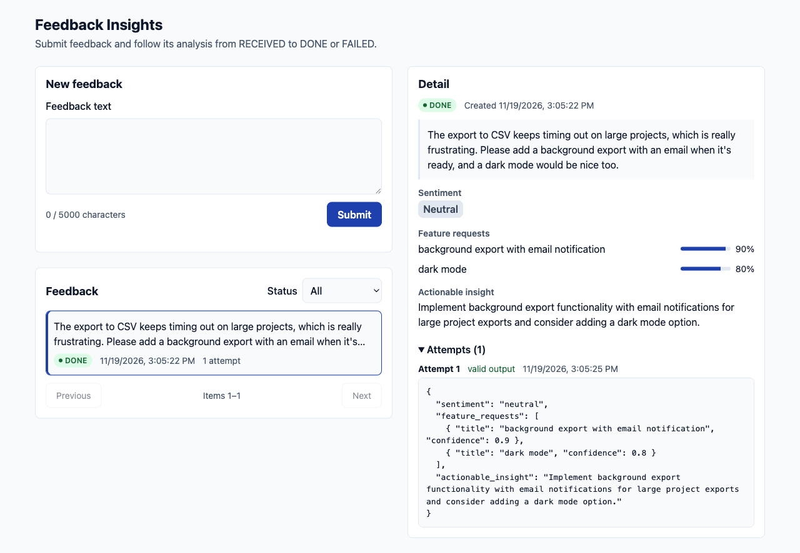

# Feedback Insights Service

A backend that accepts free-text user feedback, stores it in SQLite, and analyzes it asynchronously with an LLM into
strict, validated JSON (sentiment, feature requests with confidence, one actionable insight). Invalid model output is
sent back to the model with the validation error; items that still fail end in `FAILED`, which acts as the dead-letter
queue and can be retried by hand. A small React UI sits on top of the same API.



Demo video (35 s, real app and real model): [`docs/demo/demo.mp4`](docs/demo/demo.mp4).
Music: "Carefree" by Kevin MacLeod ([incompetech.com](https://incompetech.com)), licensed under
[CC BY 4.0](https://creativecommons.org/licenses/by/4.0/).

- Architecture, data model, state machine and flows: [`docs/ARCHITECTURE.md`](docs/ARCHITECTURE.md)
- Every tradeoff and review decision: [`docs/TRADEOFFS.md`](docs/TRADEOFFS.md)
- How it was built with AI: [`docs/AI_COLLABORATION_LOG.md`](docs/AI_COLLABORATION_LOG.md)

## Setup

Requirements: Node 24, [Ollama](https://ollama.com) running locally.

```bash
ollama pull qwen2.5:7b-instruct
npm install
npm run web:build      # optional: build the UI so the server serves it at /
npm run dev            # http://localhost:3000
```

The defaults work with a local Ollama, so no configuration is needed. Migrations run on startup, and the database is
created at `DB_PATH` (`./data/feedback.db`).

**Using OpenAI instead of Ollama** is a config change, because the client is the `openai` SDK pointed at Ollama's
OpenAI-compatible endpoint. Pass the settings as environment variables:

```bash
LLM_BASE_URL=https://api.openai.com/v1 LLM_API_KEY=sk-... LLM_MODEL=gpt-... \
ANALYSIS_CONCURRENCY=8 npm run dev   # a hosted provider handles more parallel calls than a local model
```

Configuration (environment variables with defaults, listed in `.env.example`, validated with Zod at startup): `PORT`, `DB_PATH`, `UI_DIST_PATH`, `LOG_LEVEL`,
`LLM_BASE_URL`, `LLM_API_KEY`, `LLM_MODEL`, `LLM_TIMEOUT_MS`, `LLM_SDK_MAX_RETRIES`, `MAX_ATTEMPTS`,
`ANALYSIS_CONCURRENCY`, `MAX_CONTENT_LENGTH`.

## Tests

```bash
npm run typecheck && npm run web:typecheck
npm test            # 134 tests, ~2 s, no model needed; this is what CI runs
npm run test:llm    # 15 tests against the real local model (~45 s); not in CI
```

There is no fake `LlmClient`. Normal flows are tested against the real model. Behavior a real model won't produce on
demand (invalid JSON, extra keys, HTTP 500/429/404, timeouts, late replies) is tested with a small scripted
OpenAI-compatible HTTP server behind the real SDK, queue, API and database. The real-model suite also kills the server
with `SIGKILL` mid-analysis, restarts it, and checks the item still reaches `DONE`.

## API

| Method | Path | Result |
|---|---|---|
| `POST` | `/feedback` | `202` new item (`RECEIVED`), `200` with `duplicate: true` for a duplicate, `400` invalid or too long |
| `GET` | `/feedback?status=&limit=&offset=` | list with status, attempt count and analysis (default limit 20, max 100) |
| `GET` | `/feedback/:id` | one item with its full attempt history (raw response, validated result, error) |
| `POST` | `/feedback/:id/retry` | `202` for a `FAILED` item (back to `RECEIVED`), `409` otherwise, `404` unknown id |
| `GET` | `/config` | limits the UI needs (`maxContentLength`) |

```bash
curl -s localhost:3000/feedback -H 'Content-Type: application/json' \
  -d '{"content":"The app crashes on the train. Please add an offline mode."}'
# {"id":"…","status":"RECEIVED","duplicate":false}

curl -s localhost:3000/feedback | jq '.items[] | {id, status, attemptCount, analysis}'
curl -s localhost:3000/feedback/<id> | jq .              # attempts: rawResponse, result, error
curl -s 'localhost:3000/feedback?status=FAILED' | jq .   # the dead-letter queue
curl -s -X POST localhost:3000/feedback/<id>/retry
```

`scripts/smoke.sh` runs this whole flow against a running server.

**UI:** `npm run web:build` and open `http://localhost:3000`, or `npm run web:dev` for the Vite dev server (proxies
the API to port 3000). Screenshots of every state are in [`docs/screenshots/`](docs/screenshots/).

## Design decisions and tradeoffs

The short version. Alternatives and costs for each are in [`docs/TRADEOFFS.md`](docs/TRADEOFFS.md).

| Task requirement | Decision | Why | What it costs |
|---|---|---|---|
| Async analysis, state flow | Status changes are conditional (`UPDATE … WHERE status = :from`) | Two jobs can't claim the same item; success and `DONE` are saved together | — |
| Failures explicit and retriable | `FAILED` is the dead-letter queue | No extra table; full history is kept; leaves only via `POST /feedback/:id/retry` | No separate DLQ metrics |
| Strict JSON, validated | Strict validation, no JSON repair | We see exactly what the model returned; raw output is always stored | Fixable answers need one more round trip |
| Strict JSON, validated | Invalid output is sent back to the model with the error | The model can correct itself | Up to `MAX_ATTEMPTS` (3) calls per item |
| LLM failures and retries | Network/5xx/429 errors retry inside the SDK; 404/401 fail at once | Temporary errors recover; config mistakes don't burn attempts | — |
| One guardrail | Dedup of identical requests | Double clicks and resends don't call the LLM again | Similar (not identical) feedback is analyzed twice |
| One guardrail (alternative) | Long input is rejected, not truncated | Truncating silently changes what the user said | Client must shorten long text |
| In-process queue is fine | Concurrency is configurable, not dynamic | A local model has no rate limits to react to | Doesn't back off on 429s |

**Two limits to know:**
- **Single instance only.** The queue lives in memory. A second server would reset the first one's work.
- **At-least-once.** After a crash, unfinished items are picked up again, so nothing is lost. But an LLM call can run twice.

**What validation can't do:** it checks the *shape* of the answer, not whether it's *right*. Frustrated feedback was
once classified `neutral`. A prompt injection produced a valid answer with a useless insight.

### With more time

- **Adaptive concurrency.** Lower the job limit when the provider returns 429s and raise it again as calls succeed.
  This matters once we move to a hosted model with rate limits; with a local model there is nothing to react to.
- **A durable queue, to run more than one instance.** Move jobs to BullMQ on Redis, or have workers poll the database
  and claim items with an expiry time (who owns the item, and until when). Then a second server no longer resets the
  first one's work, and a crashed server's items are picked up when its claim expires.
- **Better dedup.** Count how often the same feedback arrives, so popular requests stand out instead of collapsing into
  one row. Accept a client idempotency key for retries. Optionally group *similar* feedback with embeddings, as a
  separate feature on top of the exact dedup.
- **Measure analysis quality, not just shape.** Build a small labeled set (feedback with the expected sentiment and
  feature requests), run it on every prompt or model change, and track accuracy. Today a valid answer can still be
  wrong, and nothing would tell us.
- **Deterministic LLM tests in CI.** Record real model responses once and replay them through the scripted server, so
  CI covers the real-model flows without running Ollama.

## AI Collaboration Log

See [`docs/AI_COLLABORATION_LOG.md`](docs/AI_COLLABORATION_LOG.md): tools used, prompts, where the AI was wrong and how
it was corrected, and what I'd improve.
