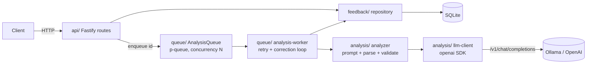
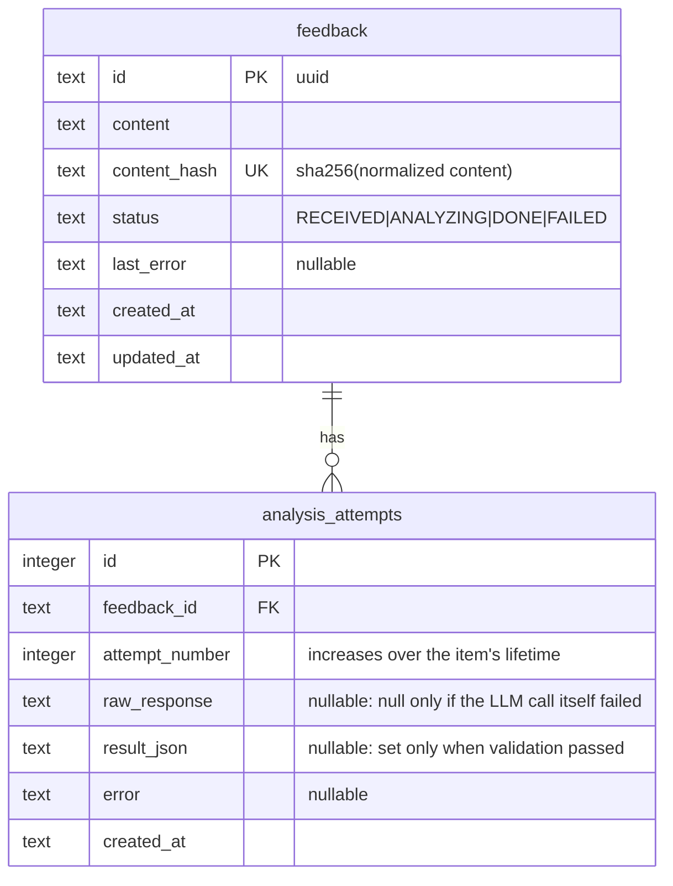
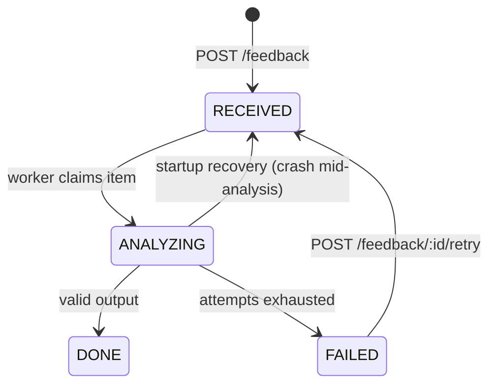
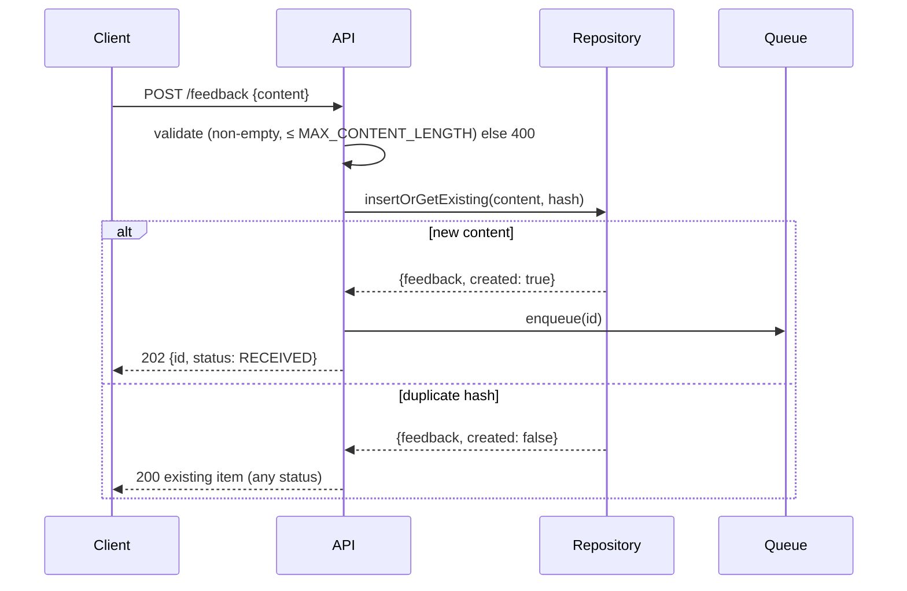
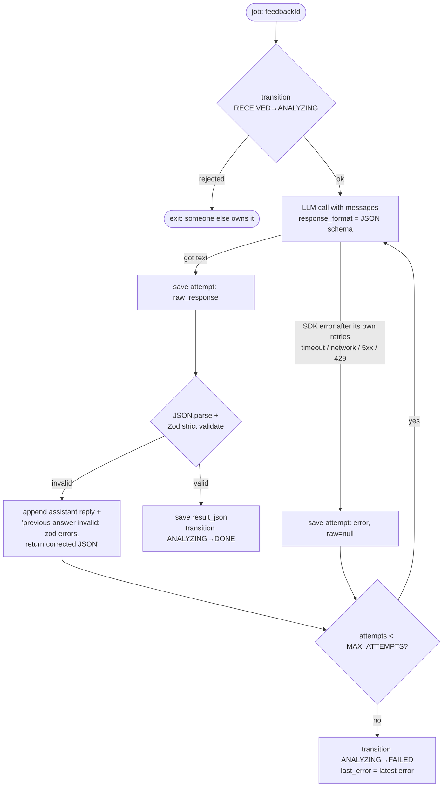

# Architecture — Feedback Insights Service

A small backend that accepts free-text user feedback, stores it, and asynchronously
extracts structured insights (sentiment, feature requests, actionable insight) using an LLM.

## 1. Tech stack

| Concern | Choice | Why |
|---|---|---|
| Runtime / language | Node 24 + TypeScript | Typed contracts between modules |
| HTTP | Fastify + `fastify-type-provider-zod` | Request/response validation with the same Zod library used for LLM output |
| Database | SQLite via `better-sqlite3` + **Drizzle ORM** | Typed schema and queries, generated SQL migrations, zero DB server |
| LLM client | **`openai` SDK** pointed at Ollama's OpenAI-compatible `/v1` endpoint | Swapping to GPT later is a config change (base URL, key, model). SDK gives timeouts and transient-error retries with backoff for free |
| Model | `qwen2.5:7b-instruct` (local Ollama) | Already available locally; supports JSON-schema structured output |
| Schema validation | **Zod v4** | One schema → TS type, runtime validator, and JSON Schema (`z.toJSONSchema`) sent to the model |
| Queue | **`p-queue`** (in-process) | Concurrency-limited async queue; the challenge allows an in-process queue |
| Tests | Vitest | Fast, TS-native |

## 2. Components

| Module | Responsibility | Knows about |
|---|---|---|
| `config.ts` | Read and validate env vars once | — |
| `domain/types.ts` | Shared types: `FeedbackStatus`, `Feedback`, `AnalysisAttempt`, `AnalysisResult` | — |
| `db/` | Drizzle schema, connection, run migrations | — |
| `feedback/` | Repository: dedup insert, **conditional status transitions**, reads, attempt records | db, domain |
| `analysis/` | Zod output schema, prompt builder, LLM client, `analyzeOnce()` → typed outcome | domain |
| `queue/` | `AnalysisQueue` (p-queue wrapper) and `processFeedback()` worker (retry loop, state changes) | feedback, analysis |
| `api/` | Fastify routes, `buildApp(deps)`, request + response Zod schemas (the API contract, importable by a future UI) | feedback, queue (only `enqueue`) |
| `server.ts` | Wiring, startup recovery, listen | everything |

Rule: `analysis/` never touches the DB; `api/` never calls the LLM. The worker is the only place that
connects the two.

## 3. Data model

- **Raw response** of every LLM call is persisted, valid or not — it is the evidence for failures.
- **Validated result** is stored on the attempt that passed. A `DONE` item has exactly one attempt
  with `result_json`, because success ends the run.

## 4. State machine

- Every transition goes through one repository function:
  `transition(id, from, to, extra?)` → `UPDATE feedback SET status=:to, updated_at=now WHERE id=:id AND status=:from`.
  It returns whether a row changed. If not, the transition is rejected.
- This makes the **claim** atomic: two queue jobs for the same id (double retry click, recovery +
  enqueue) cannot both move `RECEIVED → ANALYZING`; the loser exits without doing anything.
- **FAILED is the DLQ.** Items land there after `MAX_ATTEMPTS`, keep `last_error` and all attempts,
  and are listed with `GET /feedback?status=FAILED`. Leaving it is only possible by explicit retry.

## 5. Flows

### 5.1 Submit feedback

The response never waits for analysis. Dedup uses a `UNIQUE` index on `content_hash` with
`INSERT … ON CONFLICT DO NOTHING`, then reads the row, so concurrent identical submissions are safe.
Normalization before hashing: trim, collapse whitespace, lowercase.

### 5.2 Analysis job (worker)

- **Two kinds of retry:**
  - *Transport errors* (timeout, connection, 5xx, 429) — retried inside the `openai` SDK (`maxRetries`, built-in
    backoff). If they still fail, it counts as one failed attempt and the loop retries with the same messages.
  - *Invalid output* — the model's reply and the validation errors are sent back so it can correct itself.
- **Validation** (`analysis.schema.ts`): `sentiment ∈ {positive, neutral, negative}`,
  `feature_requests: {title: non-empty string, confidence: 0..1}[]` (may be empty),
  `actionable_insight: non-empty string`, extra keys rejected (`.strict()`).
  Structured output from the model makes valid JSON likely; Zod is still the source of truth.

### 5.3 Manual retry (leave the DLQ)

`POST /feedback/:id/retry` → 404 if unknown → `transition(FAILED → RECEIVED)` → 409 if the item
is not FAILED → enqueue → 202. A retry starts a fresh run of `MAX_ATTEMPTS`; `attempt_number`
keeps counting up so the history stays readable.

### 5.4 Startup recovery

On boot, before listening: `ANALYZING → RECEIVED` for all items (their job died with the previous
process), then enqueue every `RECEIVED` item. Without this, an in-process queue loses work on restart.

### 5.5 Read

| Endpoint | Returns |
|---|---|
| `GET /feedback?status=&limit=&offset=` | Items newest first: `id, content, status, created_at, updated_at, last_error, attempt_count, analysis` |
| `GET /feedback/:id` | Same item plus `attempts[]` (raw responses, errors) |

`analysis` is the validated result and is non-null only when `status = DONE`.

## 6. Concurrency

- LLM calls are **I/O-bound**, so concurrency is plain async inside one Node process. Worker threads or
  extra processes would add complexity without speeding anything up.
- The concurrency limit lives in **one place**: `AnalysisQueue` (`p-queue` with
  `concurrency = ANALYSIS_CONCURRENCY`). Default `2` for local Ollama; raise it for GPT.
  (Ollama also needs `OLLAMA_NUM_PARALLEL` ≥ that value to actually run requests in parallel.)
- Safety under concurrency comes from the **conditional transition claim** (§4), not from the queue.
- `better-sqlite3` is synchronous on a single connection, so DB writes never interleave. WAL mode is on.

## 7. Configuration

| Env var | Default | Purpose |
|---|---|---|
| `LOG_LEVEL` | `info` | Pino log level: fatal, error, warn, info, debug, trace, or silent |
| `PORT` | `3000` | HTTP port |
| `DB_PATH` | `./data/feedback.db` | SQLite file |
| `LLM_BASE_URL` | `http://localhost:11434/v1` | Ollama, or `https://api.openai.com/v1` |
| `LLM_API_KEY` | `ollama` | Ignored by Ollama, required by OpenAI |
| `LLM_MODEL` | `qwen2.5:7b-instruct` | Model name |
| `LLM_TIMEOUT_MS` | `60000` | Per-call timeout |
| `LLM_SDK_MAX_RETRIES` | `2` | Transport retries inside the SDK |
| `MAX_ATTEMPTS` | `3` | Analysis attempts per run before FAILED |
| `ANALYSIS_CONCURRENCY` | `2` | Parallel analysis jobs (read once at startup) |
| `MAX_CONTENT_LENGTH` | `5000` | Max feedback length in characters; longer → 400 |

## 8. Guardrail: hash-based dedup

**Chosen** because it is deterministic and easy to test, it stops the most likely waste (repeated submits and
client retries re-running the LLM), and it uses the database's unique index rather than in-memory state.
**Tradeoff:** near-duplicates ("Add dark mode" vs "add dark mode please") are analyzed separately,
and a FAILED duplicate is returned as FAILED rather than re-analyzed, so the caller must retry explicitly.

## 9. Known tradeoffs / out of scope

- In-process queue: jobs live in memory; startup recovery covers crashes, but there is no multi-instance support.
- Content over `MAX_CONTENT_LENGTH` is rejected, not truncated.
- Concurrency is fixed per process. Adaptive concurrency (back off on 429s) is future work.
- No auth, no deployment config (explicitly out of scope). The UI is a minimal Vite + React page (`web/`) built on the API's Zod schemas; served by Fastify when built.
- Tests that need the LLM call the real local Ollama. They are slower and not deterministic, so the
  correction path is unit-tested on the pure functions (validation, correction message), not by forcing a bad model output.
