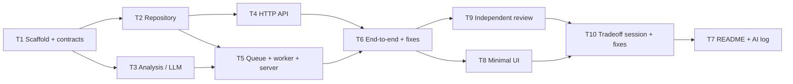

# Task plan

Integration branch: `home-task-orchestration-plan`. Each task runs as a separate Orca worker on
its own branch `task/T<n>-<name>`; the manager reviews each PR and the owner merges it into the integration branch.

Agents are mixed to spread token use: Claude for T1–T5 and T8 (T8 needs the `ui-ux-pro-max` skill and Playwright MCP),
Codex (`gpt-6.1-sol`, medium effort) for T6, T9 (review), and follow-up fixes where possible. Codex reads `AGENTS.md`, which points to `CLAUDE.md`.

| Task | Brief | Depends on | Est. |
|---|---|---|---|
| T1 | [Scaffold + contracts](T1-scaffold.md) | — | 25m |
| T2 | [Feedback repository](T2-repository.md) | T1 | 30m |
| T3 | [Analysis / LLM](T3-analysis.md) | T1 | 35m |
| T4 | [HTTP API](T4-api.md) | T2 | 25m |
| T5 | [Queue, worker, server](T5-queue-worker.md) | T2, T3 | 35m |
| T6 | [End-to-end + fixes](T6-e2e.md) | T4, T5 | 25m |
| T8 | [Minimal UI](T8-ui.md) (uses `ui-ux-pro-max`) | T6 (only once the backend is proven end to end) | 35m |
| T9 | [Independent code review](T9-review.md) (read-only, Codex) | T6 (parallel with T8) | 25m |
| T10 | [Tradeoff session + review fixes](T10-tradeoffs.md) | T9, T8 | 25m (manager + owner, fixes by workers) |
| T7 | [README + AI Collaboration Log](T7-readme.md) | T10 (written last, once everything is done) | 20m (manager + owner) |

Every worker: read `CLAUDE.md`, `docs/ARCHITECTURE.md`, and your brief. Stay inside your file list.
Done means: `npm run typecheck` and `npm test` pass locally (plus `npm run test:llm` where the brief says so),
`docs/ai-notes/T<n>.md` is written, and a PR into the integration branch has **green CI**.

## Integration gates

| Level | Where | What it proves |
|---|---|---|
| Module tests with real SQLite | each task's tests | the module works against the real schema and migrations |
| CI on the PR | GitHub Actions, run by the worker via `gh pr checks --watch` | the task works merged with everything already on the integration branch |
| LLM tests | locally, `npm run test:llm` (never in CI: no Ollama on runners) | prompts and schema work with the real model |
| End-to-end | T6 | the whole flow, including failure → DLQ → retry and restart recovery |

Only green PRs are merged, and only by the owner. The manager reviews each PR first, and runs `npm run test:llm` on the integration branch after T3, T5, and T6 are merged.
"Done when … committed on `task/…`" in a brief also means the PR above is open and green.
